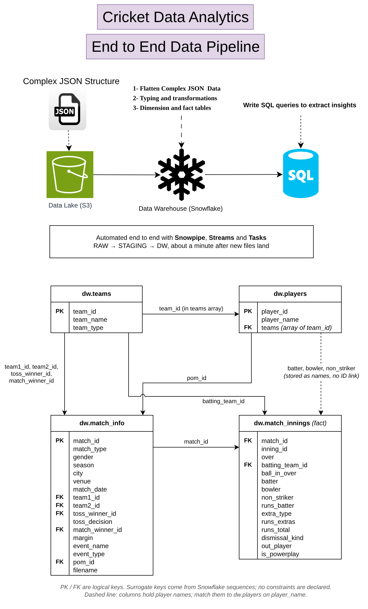
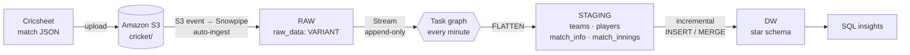
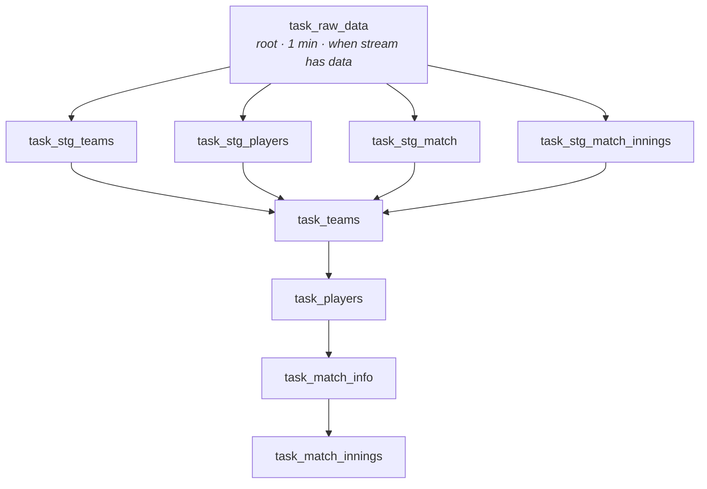

# Cricket Analytics: End-to-End ELT Pipeline on Snowflake

An automated pipeline that loads ball-by-ball cricket data (nested JSON from [Cricsheet](https://cricsheet.org)) from Amazon S3 into Snowflake and models it as a star schema, ready for SQL analysis. New match files dropped into S3 flow through to the warehouse within minutes, with no manual steps.

**Stack:** AWS S3 · Snowflake · Snowpipe · Streams · Tasks · SQL

## Architecture

<p align="center">
  
</p>

<sub>Pipeline and warehouse tables exactly as implemented in <code>sql/</code>. Editable source: <a href="docs/architecture.drawio"><code>docs/architecture.drawio</code></a>.</sub>

### How data flows



| Layer | Schema | What happens |
|---|---|---|
| Raw | `raw` | Snowpipe copies each new JSON file into one `VARIANT` row with its file name. An append-only stream records the new rows. |
| Staging | `staging` | When the stream has data, a root task moves the batch into staging and four child tasks flatten it (up to three levels: innings → overs → deliveries) into typed tables. |
| Warehouse | `dw` | Downstream tasks assign surrogate keys and load dimensions and facts incrementally. Teams and matches already loaded are skipped and players are merged, so re-processing a file never creates duplicates. |

### Task graph



## Data model

The four `dw` tables and their relationships are shown in the diagram at the top of this page.

`match_innings` is the fact table, with one row per delivery. A powerplay flag is derived from the powerplay recorded in each file, falling back to format defaults (T20: overs 1–6, ODI: overs 1–10) when the file doesn't record one.

## Repository layout

```
cricket-snowflake-elt/
├── sql/
│   ├── 00_setup.sql               database, schemas, warehouse
│   ├── 01_tables.sql              tables and sequences for all layers
│   ├── 02_raw_ingestion.sql       storage integration, stage, Snowpipe, stream
│   ├── 03_staging_tasks.sql       root task + flattening tasks
│   ├── 04_dw_tasks.sql            incremental loads into the star schema
│   ├── 05_enable_tasks.sql        start / stop the task graph
│   └── 06_checks_and_insights.sql monitoring + example analysis
├── data/
│   ├── README.md                  source and licence
│   └── sample/211048.json         one sample match
├── docs/
│   ├── architecture.png           pipeline and data model (shown above)
│   └── architecture.drawio        editable source
└── LICENSE
```

## How to run it

**You need:** a Snowflake account (a free trial works) with `ACCOUNTADMIN`, and an AWS account with an S3 bucket.

1. **Set up Snowflake objects.** Run `00_setup.sql` and then `01_tables.sql`.
2. **Connect S3.** In `02_raw_ingestion.sql`, replace `<AWS_ACCOUNT_ID>`, `<IAM_ROLE_NAME>` and `<S3_BUCKET>`, then run it step by step:
   - after `describe storage integration`, add the returned IAM user ARN and external ID to your IAM role's trust policy ([Snowflake guide](https://docs.snowflake.com/en/user-guide/data-load-s3-config-storage-integration));
   - after `show pipes`, create an S3 event notification on the `cricket/` prefix that sends to the pipe's `notification_channel` (SQS ARN).
3. **Create the task graph.** Run `03_staging_tasks.sql`, then `04_dw_tasks.sql`, then `05_enable_tasks.sql`.
4. **Load data.** Upload `data/sample/211048.json` (or any Cricsheet JSON files) to `s3://<S3_BUCKET>/cricket/`. Within about a minute of Snowpipe landing the files, the tasks run and the `dw` tables fill.
5. **Explore.** Run `06_checks_and_insights.sql`.

> **Cost tip:** the root task checks the stream every minute but only starts the warehouse when there is new data. Suspend it when you're done: `alter task dw.task_raw_data suspend;`

## Example output

From the included sample, the first men's T20 international (New Zealand v Australia, Eden Park, 17 Feb 2005, won by Australia by 44 runs):

| Batting team | Runs | Wickets | Powerplay runs (overs 1–6) | Overs 7–20 |
|---|---:|---:|---:|---:|
| Australia | 214 | 5 | 58 | 156 |
| New Zealand | 170 | 10 | 52 | 118 |

| Batter | Runs | Balls | Strike rate |
|---|---:|---:|---:|
| RT Ponting | 98 | 55 | 178.2 |
| SB Styris | 66 | 39 | 169.2 |
| BB McCullum | 36 | 24 | 150.0 |

## Design notes

- **ELT, not ETL.** JSON is landed untouched as `VARIANT` and transformed inside Snowflake with `LATERAL FLATTEN`, so the raw file is always available for reprocessing.
- **Event-driven and incremental.** Snowpipe reacts to S3 events and the stream hands each new batch to the task graph exactly once.
- **Idempotent loads.** Filtering on file name and team name, plus `MERGE` for players, means a re-run cannot duplicate data.
- **Known limitations.** `ball_in_over` counts every delivery, including wides and no-balls. Only the first wicket on a delivery is kept. The staging tables hold one batch at a time.

## Data and licence

Match data comes from [Cricsheet](https://cricsheet.org) and is used under the [Open Data Commons Attribution License](https://opendatacommons.org/licenses/by/1-0/). See [`data/README.md`](data/README.md). The code is released under the [MIT licence](LICENSE).

---

Built by **Adam Ali Rozi**, [LinkedIn](https://www.linkedin.com/in/adam-ali-rozi-504822139/) · [GitHub](https://github.com/adamalirozi)
